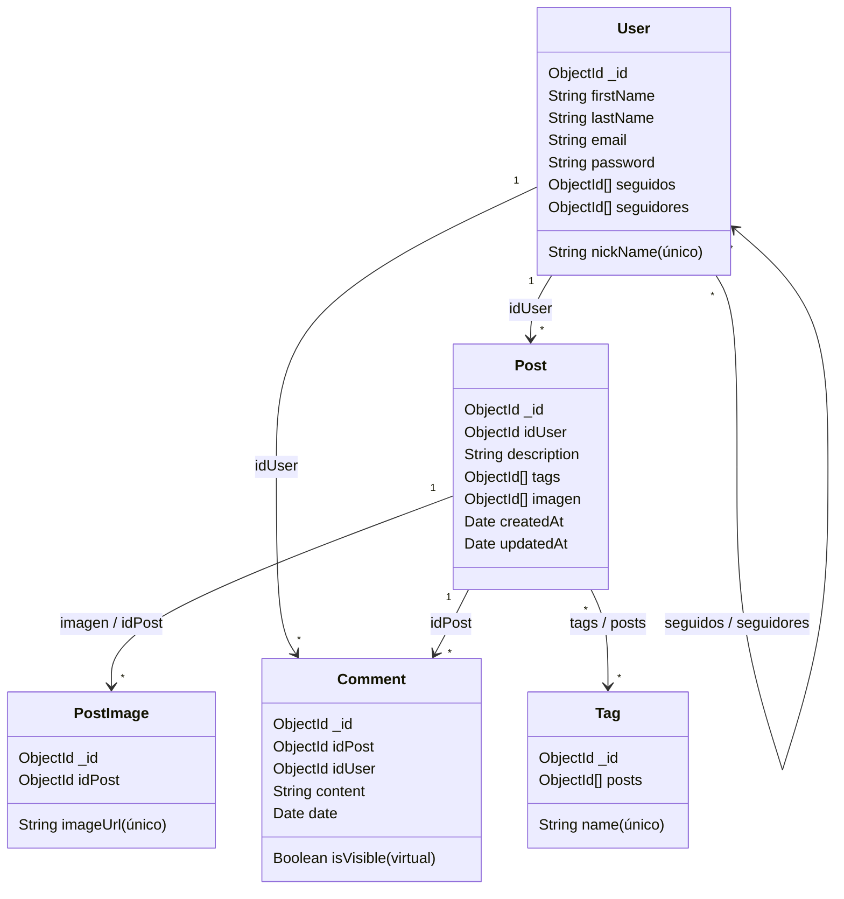

# 🌐 UnaHur Anti-Social Net — TP2 (MongoDB)

**Universidad Nacional de Hurlingham (UNAHUR)**
**Materia:** Estrategias de Persistencia — C2 2026
**Equipo:** compilaporfavor
**Integrantes:** _(completar)_

API REST del backend de **UnaHur Anti-Social Net**, una red social donde los usuarios publican posts con imágenes y etiquetas y reciben comentarios. Es la segunda etapa del TP1: el dominio y las reglas de negocio son los mismos, pero la persistencia se migró de una base relacional (Sequelize) a **MongoDB** con **Mongoose**.

> La consigna original del trabajo práctico está en [`CONSIGNA.md`](./CONSIGNA.md).

---

## 🧰 Stack

- **Node.js** + **Express 5**
- **MongoDB** accedido exclusivamente con **Mongoose** (schemas y modelos)
- **Joi** para validar los datos de entrada, aplicado mediante middlewares
- **Swagger UI** (`swagger-ui-express` + `yamljs`) para la documentación
- **Jest** + **Supertest** + **mongodb-memory-server** para las pruebas

---

## 🚀 Cómo levantar el proyecto desde cero

### 1. Requisitos previos

- **Node.js 18** o superior
- Alguna de estas opciones de MongoDB:
  - **Docker** (recomendado, el repo ya incluye `compose.yml`)
  - MongoDB instalado localmente
  - Un cluster en **MongoDB Atlas**

### 2. Clonar el repositorio e instalar dependencias

```bash
git clone https://github.com/camilaparedes21/API-Persistencia-.git
cd API-Persistencia-
npm install
```

### 3. Levantar MongoDB

**Opción A: con Docker (recomendada)**

```bash
docker compose up -d
```

Esto levanta dos contenedores:

| Servicio        | Dirección                   | Para qué sirve                            |
|-----------------|-----------------------------|-------------------------------------------|
| `mongodb`       | `mongodb://127.0.0.1:27017` | La base de datos (MongoDB 8.0)            |
| `mongo-express` | http://localhost:8081       | Interfaz web para ver colecciones y datos |

Los datos se guardan en el volumen `mongodb_data`, así que no se pierden al reiniciar los contenedores. Para detenerlos: `docker compose down`. Para borrar también los datos: `docker compose down -v`.

**Opción B: MongoDB local.** Con el servicio de MongoDB corriendo en el puerto 27017 alcanza; no hay que cambiar nada.

**Opción C: MongoDB Atlas.** Crear un cluster, habilitar el acceso desde tu IP y copiar la cadena de conexión en `MONGO_URI` (ver el paso siguiente).

### 4. Configurar las variables de entorno

Crear un archivo `.env` en la raíz del proyecto:

```env
PORT=3000
MONGO_URI=mongodb://127.0.0.1:27017/red-antisocial
COMMENT_MAX_AGE_MONTHS=6
```

| Variable                 | Descripción                                                                 | Valor por defecto |
|--------------------------|-----------------------------------------------------------------------------|-------------------|
| `PORT`                   | Puerto donde escucha el servidor                                            | `3000`            |
| `MONGO_URI`              | Cadena de conexión a MongoDB (local, Docker o Atlas)                        | _(obligatoria)_   |
| `COMMENT_MAX_AGE_MONTHS` | Antigüedad máxima (en meses) de un comentario para que se muestre en un post | `6`               |

Para usar Atlas solo hay que cambiar `MONGO_URI`, por ejemplo:

```env
MONGO_URI=mongodb+srv://<usuario>:<contraseña>@<cluster>.mongodb.net/red-antisocial
```

Si `COMMENT_MAX_AGE_MONTHS` no es un entero mayor o igual a 0, se usa el valor por defecto y se muestra una advertencia en la consola.

### 5. Ejecutar el servidor

```bash
npm start      # modo normal
npm run dev    # modo desarrollo, con nodemon
```

Si todo está bien, la consola muestra `Conectado a MongoDB exitosamente` y `Servidor escuchando en http://localhost:3000`.

### 6. Ejecutar las pruebas

```bash
npm test
```

Los tests usan **mongodb-memory-server**, que levanta una base de MongoDB en memoria: no hace falta tener Mongo corriendo ni se tocan los datos reales.

| Archivo                         | Qué prueba                                         |
|---------------------------------|----------------------------------------------------|
| `tests/comments-tags.test.js`   | Comentarios, etiquetas y su relación con los posts |
| `tests/post-detail.test.js`     | Detalle de un post con sus comentarios visibles    |

---

## 📖 Documentación y pruebas manuales

### Swagger

Con el servidor levantado, la documentación completa de la API (endpoints, parámetros, cuerpos, respuestas y códigos de error) está en:

**http://localhost:3000/api-docs**

La especificación está en [`swagger.yaml`](./swagger.yaml).

### Colecciones de Postman

| Archivo                               | Contenido                                               |
|---------------------------------------|---------------------------------------------------------|
| `postman_collection.json`             | Colección completa: todos los endpoints, recorrido desde una base vacía y casos de error (400, 404 y 409) |
| `docs/postman.comments-tags.json`     | Casos de comentarios y etiquetas, incluidos los de error |

**Colección completa (`postman_collection.json`):** en Postman, **Import** → elegir el archivo, y después **Run collection** para ejecutarla entera, en orden. Crea sus propios datos (usuarios, publicación, imágenes, comentarios y etiquetas), guarda los ids que devuelve la API en variables de la colección y los usa en los pedidos siguientes, así que no hay que copiar ningún id a mano. Cada pedido tiene tests que verifican el código de respuesta y el contenido. Se puede ejecutar varias veces, porque cada corrida usa nombres únicos.

El recorrido es: usuarios y seguidores → publicación e imágenes → comentarios (incluido uno viejo que no se muestra) → etiquetas → detalle completo del post → borrados en cascada (publicación y usuario).

**Colección de comentarios y etiquetas (`docs/postman.comments-tags.json`):** antes de usarla hay que completar las variables `userId` y `postId` con el `_id` de un usuario y de un post existentes.

---

## 🔗 Endpoints

### Usuarios

| Método | Ruta                         | Descripción                                      |
|--------|------------------------------|--------------------------------------------------|
| GET    | `/users`                     | Lista los usuarios                               |
| GET    | `/users/:id`                 | Obtiene un usuario                               |
| POST   | `/users`                     | Crea un usuario                                  |
| PUT    | `/users/:id`                 | Actualiza un usuario                             |
| DELETE | `/users/:id`                 | Elimina un usuario y todo lo relacionado (ver "Qué pasa al borrar") |
| PUT    | `/users/:idSeguido/seguir`   | El usuario `idSeguidor` (en el body) sigue a `idSeguido` |
| PUT    | `/users/:idSeguido/dejar-de-seguir` | El usuario `idSeguidor` (en el body) deja de seguir a `idSeguido` |

### Publicaciones e imágenes

| Método | Ruta                              | Descripción                                          |
|--------|-----------------------------------|------------------------------------------------------|
| GET    | `/posts`                          | Lista las publicaciones, de la más nueva a la más vieja |
| GET    | `/posts/:id`                      | Detalle del post con autor, imágenes, tags y comentarios visibles |
| POST   | `/posts`                          | Crea una publicación (`description`, `userId`)       |
| PUT    | `/posts/:id`                      | Modifica la descripción                              |
| DELETE | `/posts/:id`                      | Elimina el post, sus imágenes y sus comentarios      |
| POST   | `/posts/:id/images`               | Agrega una imagen al post (`url`, tiene que ser http o https) |
| DELETE | `/posts/:id/images/:imageId`      | Quita una imagen del post                            |

### Comentarios

| Método | Ruta                          | Descripción                                                 |
|--------|-------------------------------|-------------------------------------------------------------|
| GET    | `/posts/:postId/comments`     | Comentarios **visibles** de un post, del más nuevo al más viejo |
| POST   | `/posts/:postId/comments`     | Comenta un post (`userId`, `content`, `date` opcional)      |
| GET    | `/comments`                   | Lista comentarios; filtros opcionales `?visible=`, `?postId=`, `?userId=` |
| GET    | `/comments/:id`               | Obtiene un comentario                                       |
| PUT    | `/comments/:id`               | Modifica un comentario                                      |
| DELETE | `/comments/:id`               | Elimina un comentario                                       |

### Etiquetas

| Método | Ruta                          | Descripción                                   |
|--------|-------------------------------|-----------------------------------------------|
| GET    | `/tags`                       | Lista las etiquetas                           |
| GET    | `/tags/:id`                   | Obtiene una etiqueta                          |
| POST   | `/tags`                       | Crea una etiqueta (`name`, único)             |
| PUT    | `/tags/:id`                   | Renombra una etiqueta                         |
| DELETE | `/tags/:id`                   | Elimina la etiqueta y la quita de los posts   |
| GET    | `/posts/:postId/tags`         | Etiquetas de un post                          |
| POST   | `/posts/:postId/tags`         | Asocia etiquetas existentes al post (`tagIds`) |
| DELETE | `/posts/:postId/tags/:tagId`  | Quita una etiqueta del post                   |

### Códigos de respuesta

| Código | Cuándo                                                                   |
|--------|--------------------------------------------------------------------------|
| 200 / 201 | Operación exitosa / recurso creado                                    |
| 204    | Borrado exitoso sin cuerpo de respuesta                                  |
| 400    | Datos inválidos (Joi) o `id` con formato que no es un ObjectId válido    |
| 404    | El recurso (o uno relacionado, como el post o el tag) no existe, o la ruta no existe |
| 409    | Valor único repetido (`nickName`, nombre de etiqueta o URL de imagen) o seguir a alguien que ya se sigue |
| 500    | Error inesperado del servidor                                            |

Todos los errores tienen el mismo formato: `{ "error": "mensaje" }`. Los errores de validación agregan además un array `details` con el campo y el problema de cada dato inválido.

---

## 🔄 Cambios de contrato respecto del TP1

La API mantiene las mismas rutas y cuerpos que en el TP1. El único cambio visible para quien la consume es el **formato de los identificadores**:

- **TP1 (Sequelize):** ids numéricos autoincrementales (`1`, `2`, `3`…).
- **TP2 (MongoDB):** ids de tipo **ObjectId**, un string de 24 caracteres hexadecimales (por ejemplo `665f1c2e8b3a4d0012ab34cd`), en el campo `_id`.

Un id con otro formato devuelve **400** en lugar de 404, para distinguir "id mal escrito" de "no existe".

---

## 🗂️ Estructura del proyecto

```text
.
├── src/
│   ├── config/       # Conexión a la base y regla de antigüedad de comentarios
│   ├── controllers/  # Controladores: solo ejecutan la operación
│   ├── helpers/      # Filtros de visibilidad de comentarios
│   ├── middlewares/  # Validación con Joi, existencia de entidades y manejo de errores
│   ├── models/       # Modelos de Mongoose (User, Post, PostImage, Comment, Tag)
│   ├── routes/       # Routers de Express
│   ├── schemas/      # Schemas de validación con Joi
│   ├── utils/        # HttpError (lo convierte el errorHandler) y hash de contraseñas
│   ├── app.js        # Configuración de Express, rutas y Swagger
│   └── index.js      # Punto de entrada: conecta a MongoDB y levanta el servidor
├── tests/            # Pruebas de integración (Jest + Supertest)
├── docs/             # Colección extra de Postman
├── assets/           # Imágenes del enunciado
├── compose.yml       # MongoDB + mongo-express con Docker
├── swagger.yaml      # Especificación OpenAPI
└── postman_collection.json
```

La aplicación (`app.js`) está separada del arranque del servidor (`index.js`) para que los tests puedan usar la app sin abrir un puerto ni conectarse a la base real.

---

## 🧩 Modelo documental

### Diagrama



**Colecciones:** `users`, `posts`, `postimages`, `comments` y `tags`.
**Índices únicos:** `users.nickName`, `tags.name` y `postimages.imageUrl`.
**Índice compuesto:** `comments { idPost: 1, date: -1 }`.

En este modelo **todas las relaciones son referenciadas** por `_id`; no hay documentos embebidos.

**Fecha de las publicaciones:** el schema de `Post` usa `timestamps: true`, así que cada publicación guarda `createdAt` (cuándo se publicó) y `updatedAt` (última modificación). El listado de publicaciones se ordena por `createdAt`, de la más nueva a la más vieja.

### Justificación: embebido vs. referenciado

#### Imágenes → colección propia, referenciada

- **Cómo se guarda:** cada imagen es un documento en `postimages` con su `idPost`, y el post guarda además el array `imagen` con los ids de sus imágenes.
- **Cómo se consulta:** el detalle del post hace `populate('imagen')` y trae las URLs en la misma respuesta.
- **Por qué no embebidas:** como cada imagen tiene su propio `_id`, se puede agregar o quitar una sola (`DELETE /posts/:id/images/:imageId`) sin reescribir el post. Además, el índice único sobre `imageUrl` evita que la misma URL se cargue dos veces, algo que no se puede garantizar fácilmente con un array embebido.
- **Costo:** hay que mantener sincronizados `Post.imagen` y `PostImage.idPost`.

#### Comentarios → colección propia, referenciada

- **Cómo crece:** un post puede acumular una cantidad ilimitada de comentarios. Si estuvieran embebidos, el documento del post crecería sin límite y podría acercarse al **máximo de 16 MB** que permite MongoDB por documento.
- **Cómo se consulta:** los comentarios se filtran por fecha **en la propia consulta** (`date >= fecha límite`), usando el índice `{ idPost, date }`. Así la base devuelve solo los visibles, ya ordenados del más nuevo al más viejo. Con comentarios embebidos habría que traer todos y filtrarlos en memoria.
- **Al modificar:** editar o borrar un comentario toca un solo documento, sin reescribir el post.

#### Etiquetas → muchos a muchos con referencias en los dos lados

- En lugar de una tabla intermedia, la relación se guarda en **ambos documentos**: `Post.tags` (ids de sus etiquetas) y `Tag.posts` (ids de sus publicaciones).
- **Ventaja:** se pueden consultar en las dos direcciones sin joins: las etiquetas de un post y los posts de una etiqueta.
- **Costo:** cada operación tiene que actualizar los dos lados. Asociar usa `$addToSet` en ambos (no se duplican) y desasociar usa `$pull` en ambos.
- Las etiquetas no se embeben porque una misma etiqueta se comparte entre muchos posts: si se embebiera el nombre, renombrar una etiqueta obligaría a modificar todos los posts que la usan.

#### Seguidores (bonus) → auto-referencia en `User`

- Cada usuario guarda `seguidos` y `seguidores` como arrays de ids de otros usuarios. Seguir a alguien hace `$addToSet` en los dos usuarios a la vez, y dejar de seguir hace `$pull` en los dos.
- No se puede seguir a uno mismo, seguir dos veces al mismo usuario (409) ni dejar de seguir a alguien que no se sigue (400).
- **Comparación con el modelo relacional:** en SQL se usaría una tabla intermedia `follows (followerId, followedId)` con clave primaria compuesta. En MongoDB los arrays reemplazan a esa tabla, y contar seguidores es simplemente el largo del array, sin `COUNT` ni `JOIN`. La desventaja es que la consistencia entre los dos arrays depende de la aplicación, y que un usuario con muchísimos seguidores haría crecer mucho su documento.

### Visibilidad de comentarios (regla de los X meses)

Que un comentario sea visible **no se guarda en la base**: se calcula a partir de su fecha y de `COMMENT_MAX_AGE_MONTHS`, de dos formas que usan la misma fecha límite:

1. **Filtro en la consulta:** `GET /posts/:id` y `GET /posts/:postId/comments` traen de la base solo los comentarios con `date` mayor o igual a la fecha límite.
2. **Virtual de Mongoose `isVisible`:** cada comentario que se devuelve incluye `isVisible: true/false`, calculado al leerlo. Sirve, por ejemplo, en `GET /comments?visible=false` para ver los ocultos.

La fecha límite se calcula restando meses de calendario (si el día no existe en el mes destino, se usa el último día de ese mes). Cambiar `X` solo requiere modificar la variable de entorno y reiniciar el servidor.

### Integridad referencial

MongoDB no controla claves foráneas, así que lo garantiza la aplicación mediante middlewares, antes de llegar al controlador:

- Todos los datos de entrada (body, parámetros y query) se validan con schemas de **Joi** aplicados como middlewares, así los controladores sólo hacen la operación. La URL de una imagen tiene que ser una dirección `http` o `https` válida.
- Los ids se validan como ObjectId (si no, **400**).
- Se verifica que existan las entidades relacionadas: no se puede comentar un post o con un usuario inexistente, ni asociar un tag que no existe, ni quitar de un post un tag que no tiene (**404**).
- El `nickName` es único mediante un índice único en el schema (si se repite, **409**).

### Contraseñas

- Las contraseñas **nunca se guardan en texto plano**: antes de guardar un usuario, un hook `pre('save')` del modelo las reemplaza por un hash **scrypt** con un salt aleatorio propio (módulo `crypto` de Node, en `src/utils/password.js`).
- El campo `password` tiene `select: false`, así que no se trae en las consultas, y además el modelo lo quita de cualquier respuesta JSON. Ningún endpoint devuelve la contraseña.

### Qué pasa al borrar

MongoDB no borra en cascada, así que cada borrado limpia lo relacionado:

| Se borra    | Qué pasa con lo relacionado                                                                 |
|-------------|---------------------------------------------------------------------------------------------|
| **Post**    | Se borran sus imágenes y sus comentarios, y se quita su id de `Tag.posts` en todas las etiquetas. |
| **Usuario** | Se borran sus publicaciones, junto con las imágenes y los comentarios (de cualquier usuario) de esas publicaciones, y esas publicaciones se quitan de `Tag.posts`. También se borran los comentarios que escribió en publicaciones de otros y se quita su id de los `seguidos` y `seguidores` de los demás usuarios. |
| **Tag**     | Se quita su id de `Post.tags` en todas las publicaciones. Los posts no se borran.            |
| **Comentario** | Se borra solo el comentario.                                                              |
| **Imagen**  | Se borra el documento de la imagen y se quita del post.                                      |
